# Batocera Rom Manager

A web ROM manager for [Batocera](https://batocera.org/), reachable from any device on the home network.

It runs on the Batocera machine as a service and reads the game list from EmulationStation, so it always shows what the TV shows.

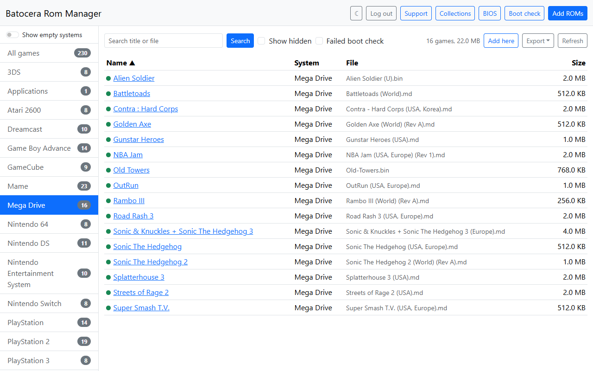

## Features

- Games table with name, system, file and size, sortable by any column, with search and an option to show hidden games.
- Export the games list as shown to CSV or TXT.
- Game page with scraped media, description, metadata, play stats and every file the game uses (`.cue`/`.gdi` tracks, `.m3u` discs).
- Edit a game's info, replace or remove its scraped media, or delete it with its files and media.
- Start a game on the TV from its page, and see or quit the running game from the top bar.
- Add ROMs by uploading them from the browser or by giving download links, which run in the background with speed and time left.
- BIOS page: what Batocera's own BIOS check reports as missing or wrong, with upload or download to the exact path, plus a browser of the BIOS folder.
- Collections: turn EmulationStation's automatic and per-genre collections on or off, group them, and create manual collections or dynamic ones filtered by system, genre and players.
- Boot check: starts each game of a system or of the whole library on the TV and marks it green or red, depending on whether it keeps running without emulator errors.
- Support page with the Batocera version, uptime, EmulationStation state and free space, plus buttons to restart EmulationStation or the app.
- Light and dark theme, following the device until you pick one.

| | |
|---|---|
| 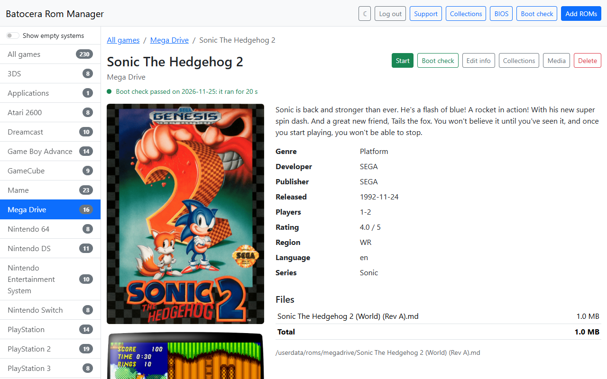 Game page | 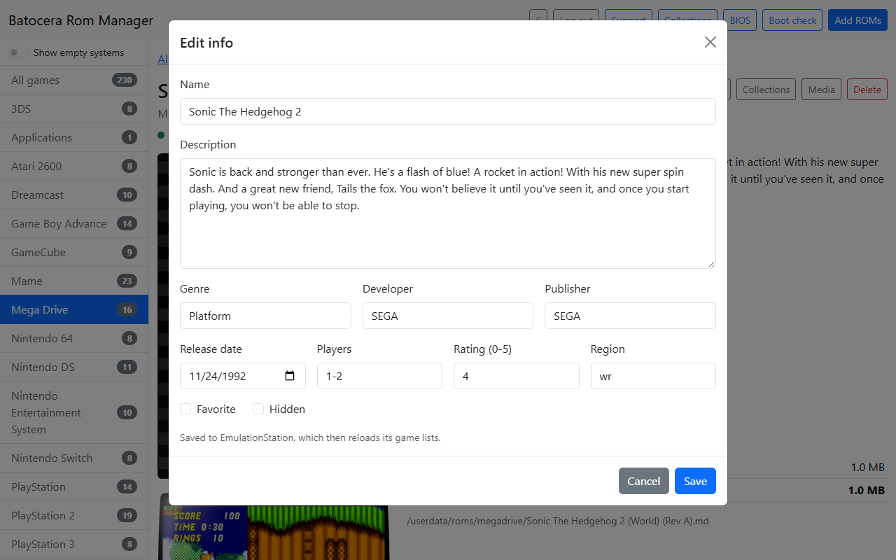 Edit info |
| 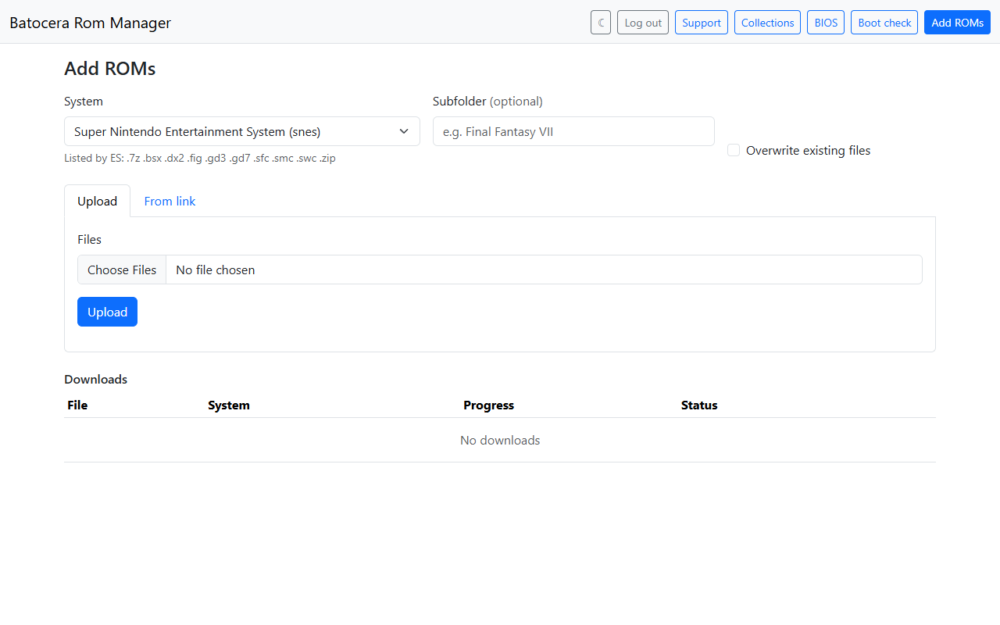 Add ROMs | 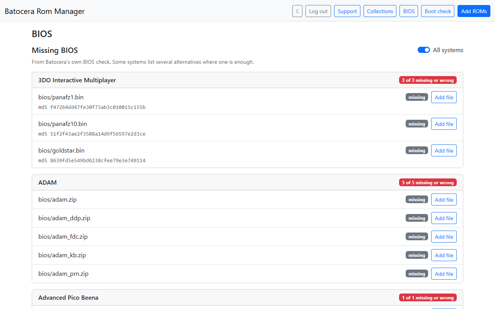 BIOS |
| 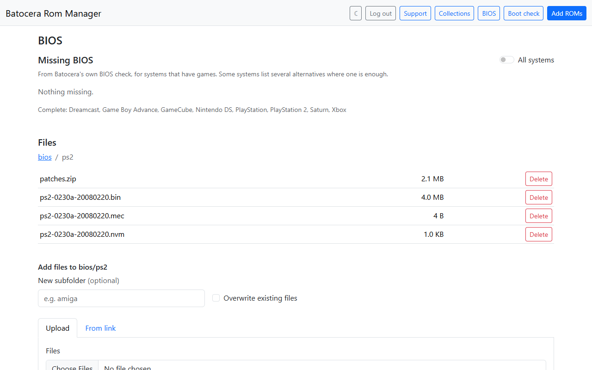 BIOS folder | 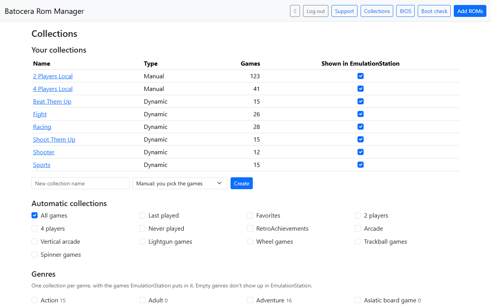 Collections |
| 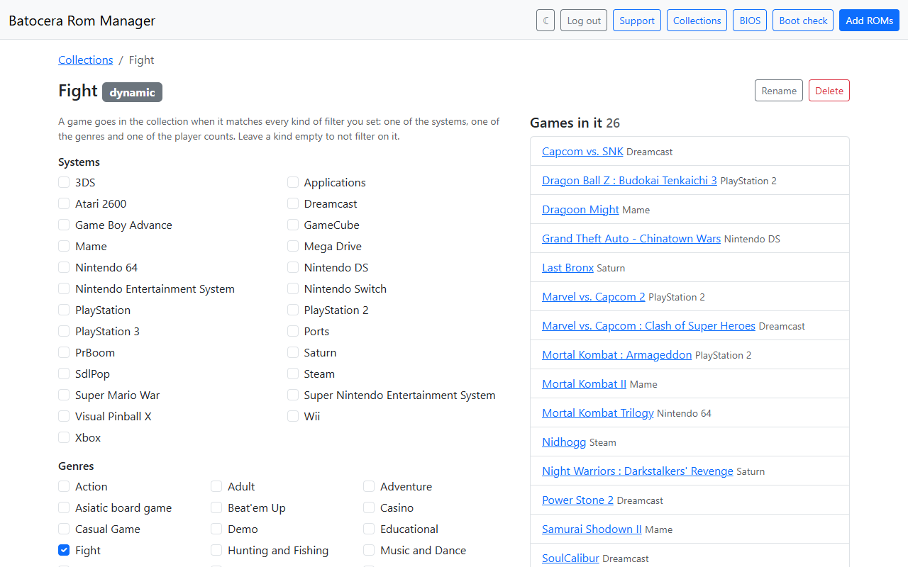 Dynamic collection | 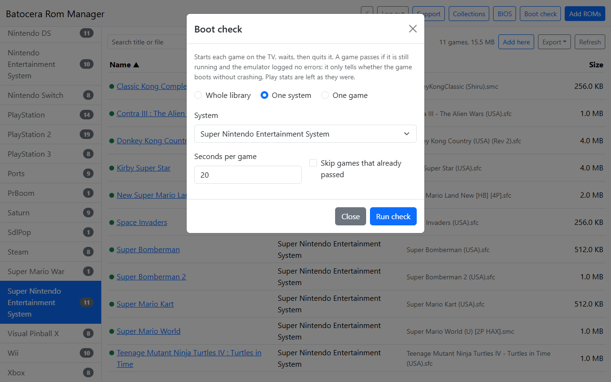 Boot check |
| 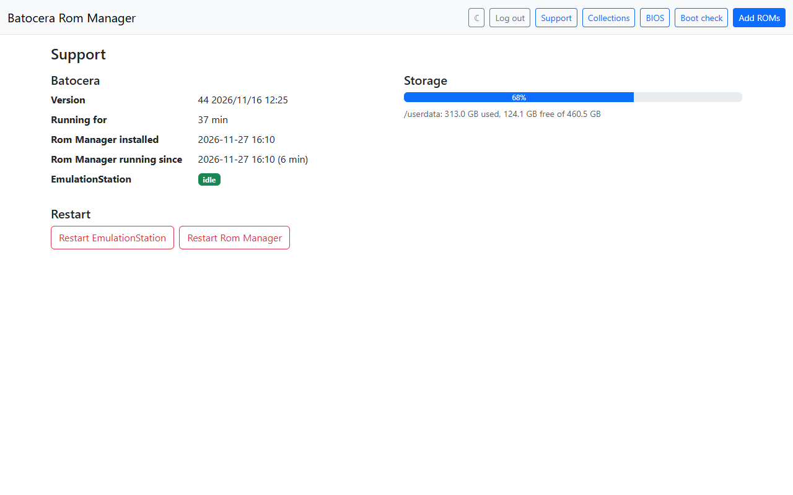 Support | 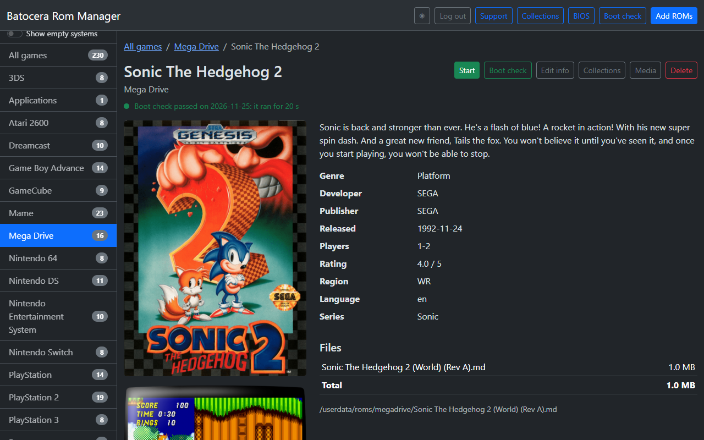 Dark theme |

## Requirements

Batocera with user services (`batocera-services`). Tested on Batocera 44.

## Install

Open a terminal on the Batocera machine (for example `ssh root@batocera.local`, default password `linux`) and run:

```sh
cd /tmp && curl -sL https://github.com/alealpha07/batocera-rom-manager/archive/refs/heads/main.tar.gz | tar xz \
  && bash batocera-rom-manager-main/install.sh && rm -rf batocera-rom-manager-main
```

Run the same command again to update.

Then open `http://<batocera-ip>:18765` in a browser. On the first visit, choose a password: every device will ask for it, and a login lasts 30 days.

The service can be turned off and on from EmulationStation: **Main menu > System settings > Services > rom_manager**.

## Good to know

- The game list is kept in memory. Press **Refresh** after adding or scraping games in EmulationStation.
- Forgot the password? Delete `/userdata/system/configs/rom-manager/config.json`, run `batocera-services restart rom_manager` and choose a new one.
- It is made for the home network and uses plain HTTP. To reach it from outside, use a VPN instead of opening the port on your router.
- The log is in `/userdata/system/logs/rom-manager.log`.

## Uninstall

```sh
bash /userdata/system/rom-manager/uninstall.sh
```

This stops and disables the service and removes its files, password and log.

## Development

See [DEV.md](DEV.md).

## License

[MIT](LICENSE). Bundles [Jinja2](https://jinja.palletsprojects.com/) and [MarkupSafe](https://markupsafe.palletsprojects.com/) (BSD-3-Clause) and [Bootstrap](https://getbootstrap.com/) (MIT); their licenses are next to their files.
